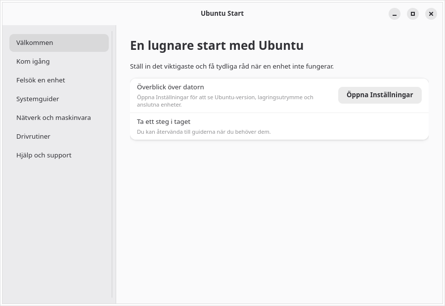

# Ubuntu Start

A Swedish-first Ubuntu Desktop companion for first-run setup and device troubleshooting.



[More screenshots](screenshots/)


Ubuntu Start combines a first-run guide with practical device troubleshooting for Ubuntu Desktop. It is a GTK 4/libadwaita application intended for Ubuntu GNOME.

## Current scope

- First steps for language, networking, updates, sound, display and privacy.
- Guided checks for sound, Bluetooth, printers, displays/graphics, Wi-Fi and cameras.
- Links into GNOME Control Center and Ubuntu's Additional Drivers tool. System changes remain in Ubuntu's own tools and require the user's confirmation.
- gettext-based localization with English source strings and a complete Swedish (`sv`) catalog.

## Build and run on Ubuntu

Install the platform dependencies, then build with Meson:

```sh
sudo apt install python3-gi gir1.2-gtk-4.0 gir1.2-adw-1 gettext meson ninja-build
meson setup build --prefix=/usr
meson compile -C build
sudo meson install -C build
```

For a source checkout, run `python3 src/ubuntu_start.py` to use the English source strings. To try the Swedish catalog from the checkout:

```sh
mkdir -p build/locale/sv/LC_MESSAGES
msgfmt po/sv.po -o build/locale/sv/LC_MESSAGES/ubuntu-start.mo
LANGUAGE=sv UBUNTU_START_LOCALEDIR="$PWD/build/locale" python3 src/ubuntu_start.py
```

The app expects GTK 4, libadwaita and PyGObject. It has been installed and launched on the Ubuntu target described below.

## Validation

On the Ubuntu 26.10 machine `trv2`, Meson configured, compiled and installed the app in the standard `/usr` application paths. The installed Python module matches the transferred source. The real desktop launcher was validated, and the installed GTK 4/libadwaita app was inspected under Xvfb with `sv_SE.utf8`; runtime inspection confirmed the Swedish welcome heading, all four navigation pages and all six device guides. The locale catalog compiled cleanly with 86 translated messages, and the desktop entry and AppStream metadata include Swedish text.

The GNOME Control Center panel list on the target confirms the app's Bluetooth, Wi-Fi, printer, display, privacy and sound panel identifiers; the language/keyboard entry uses the current `keyboard` panel ID. Both Ubuntu driver/update utilities were downloaded as `.deb` packages and installed with `dpkg -i`, together with their dependencies. `Software & Updates --open-tab=4` opened the Swedish Additional Drivers tab under Xvfb; the target currently reports that no proprietary drivers are in use. Update Manager displayed its Swedish updates screen. `dpkg --audit` is clean and `apt-get check` reports no dependency errors. A final check found no pending upgrades and no reboot-required marker. GUI inspection ran under Xvfb, which cannot verify hardware acceleration or physical-device behavior.

## Localization

Source strings are English and are marked with gettext's `_()` function. Swedish translations live in `po/sv.po`; add language codes to `po/LINGUAS` and translate through Weblate or another gettext-compatible service. Regenerate the template with `xgettext` and validate catalogs with `msgfmt --check`.

## Current limitations

This is an initial, reviewable app foundation. Hardware checks are instructional and do not probe device state. Settings panel names and the Additional Drivers launcher can differ across Ubuntu releases, so validate integrations on each supported release. The app does not install packages or run privileged operations; system changes remain in Ubuntu's own tools.


## Releases

Tagged versions (`v*`) are built and published by GitHub Actions. Each release includes a source archive and SHA-256 checksum.

## Screenshots

The screenshots show the Swedish welcome page and Ubuntu Software & Updates additional drivers tab. The latter was captured while Ubuntu was still scanning for available drivers.
