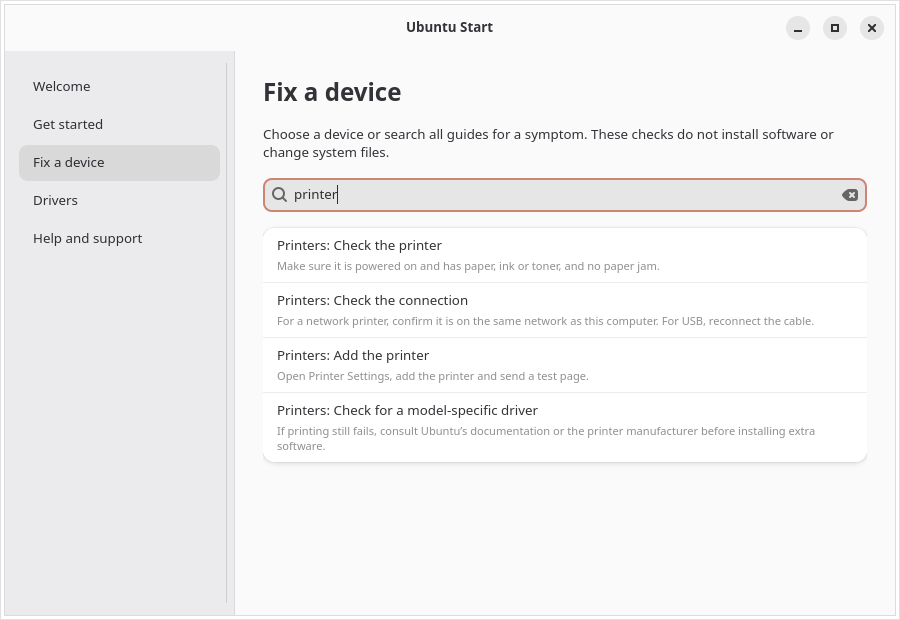
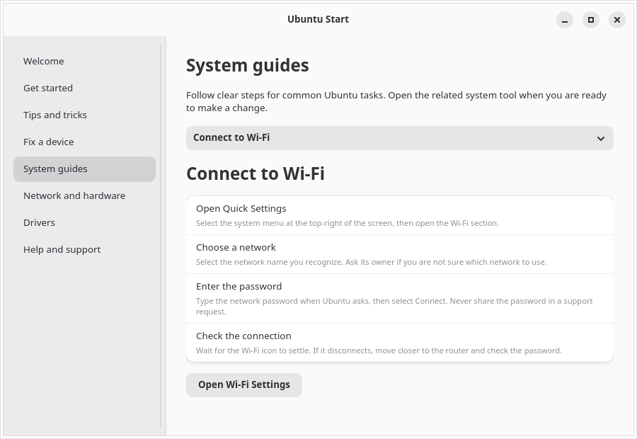
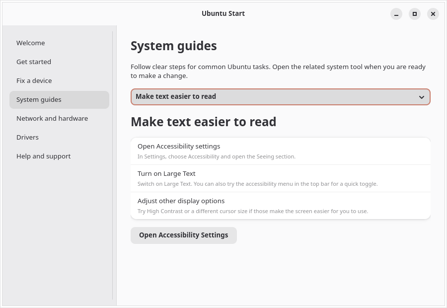
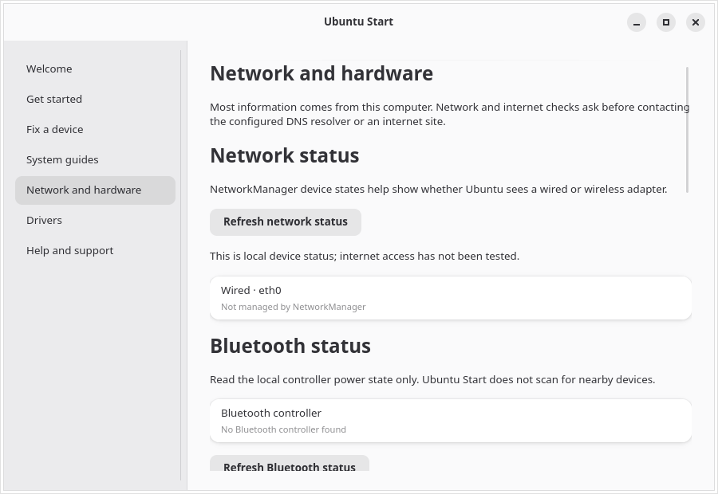

# Ubuntu Start

An Ubuntu Desktop guide for first-run setup and device troubleshooting.


[Swedish welcome screen](screenshots/welcome-sv.png) · [More screenshots](screenshots/)









[More screenshots: network diagnostics (EN)](screenshots/network-diagnostics-en.png) · [audio status (EN)](screenshots/audio-status-en.png) · [printer queues (EN)](screenshots/printer-status-en.png) · [accessibility status (EN)](screenshots/accessibility-status-en.png) · [expanded accessibility status (EN)](screenshots/accessibility-status-en-expanded.png) · [storage and battery (EN)](screenshots/storage-en.png) · [free-space guide (EN)](screenshots/storage-guide-en.png) · [system details and storage (EN)](screenshots/copy-system-details-en.png) · [USB hardware (EN)](screenshots/hardware-usb-en.png) · [Terminal guide (EN)](screenshots/terminal-guide-en.png) · [WiFi Analyzer recommendation (EN)](screenshots/wifi-analyzer-en.png) · [help page (EN)](screenshots/help-en.png) · [hardware summary (EN)](screenshots/help-hardware-en.png) · [date and time status (EN)](screenshots/date-time-en-detail.png)

[Swedish system guides](screenshots/system-guides-sv.png) · [network and hardware overview](screenshots/network-hardware-sv.png) · [network diagnostics](screenshots/network-diagnostics-sv.png) · [audio status](screenshots/audio-status-sv.png) · [printer queues](screenshots/printer-status-sv.png) · [accessibility status](screenshots/accessibility-status-sv.png) · [utökad tillgänglighetsstatus](screenshots/accessibility-status-sv-expanded.png) · [storage and battery](screenshots/storage-sv.png) · [free-space guide](screenshots/storage-guide-sv.png) · [system details and storage](screenshots/copy-system-details-sv.png) · [USB hardware](screenshots/hardware-usb-sv.png) · [Terminal guide](screenshots/terminal-guide-sv.png) · [WiFi Analyzer recommendation](screenshots/wifi-analyzer-sv.png) · [help page](screenshots/help-sv.png) · [hardware summary](screenshots/help-hardware-sv.png) · [accessibility settings](screenshots/accessibility-panel-en.png) · [datum- och tidsstatus](screenshots/date-time-sv-detail.png)


Ubuntu Start combines a first-run guide with practical device troubleshooting for Ubuntu Desktop. It is a GTK 4/libadwaita application intended for Ubuntu GNOME.

## Contributing

See [CONTRIBUTING.md](CONTRIBUTING.md) for contributor guidance and the maintainer pull request review process.

## Current scope

- First steps for language, networking, updates, sound, display and privacy.
- Everyday tips for search, window management and Files, plus guidance on backups and choosing trusted app sources.
- Search device checks and step-by-step system guides together, then open a matching guide directly. Topics include sound, Bluetooth, batteries, USB devices, printers, displays/graphics, keyboards, touchpads, Wi-Fi, Ethernet, cameras, storage, accessibility and Terminal basics.
- Dedicated USB, external-display and Bluetooth pairing guides help isolate connection, port, cable, input, adapter and pairing problems.
- Step-by-step guides for freeing disk space safely, installing apps, updates, Wi-Fi, Ethernet, printers, batteries, keyboards, touchpads, larger text, screen magnification and the Orca screen reader.
- Accessibility guides explain larger text, zoom, screen reading, the on-screen keyboard, typing assistance and visual sound alerts, with plain-language steps before each change.
- A read-only accessibility summary shows GNOME screen reader, magnifier, on-screen keyboard, high contrast, Sticky Keys, Slow Keys, Bounce Keys, visual sound alerts, text scaling and pointer size settings when available. It never changes them.
- A read-only date and time summary shows the local time zone, automatic time synchronization setting and whether the clock is synchronized. It reads `timedatectl` status only; it does not contact a time server, start synchronization or change settings.
- Refreshable resource summaries show total and available RAM, estimated use and swap use from local `/proc/meminfo`, plus Linux pressure-stall averages for CPU, memory and storage I/O. These system-wide readings can help investigate slowdowns but do not identify a process or prove the cause. A searchable guide explains how to compare them, close unused apps safely, check disk space and review Ubuntu updates.
- A system service status check lists local systemd service units marked failed and their descriptions. It does not read logs or change services; help explains that failures may be temporary or expected.
- The hardware overview shows the operating system and kernel versions alongside model, processor, memory, graphics and architecture, so users can find version details without creating a support report.
- A read-only temperature check shows values and critical limits from Linux thermal and hardware-monitor sensors when available. A searchable guide covers ventilation, interpreting model-specific limits and when to shut down and seek support; the app does not run stress tests or change fan settings.
- A local Ubuntu update check simulates `apt-get upgrade` against cached package lists. It reports packages ready to upgrade, packages held back and when the lists were last refreshed, then lets the user open Software Updater. It does not contact a network, refresh lists or install anything.
- A beginner-friendly Terminal guide explains the prompt, command output and errors, `pwd`, `ls`, `cd`, paths with spaces, Tab completion, command history, `--help`, `man`, `sudo` and safe ways to stop a command.
- Optional connection diagnostics report DNS lookup and gateway ping latency in milliseconds, plus the gateway MAC address and a local OUI vendor match. The test asks before running; it sends one DNS lookup to the configured resolver and one ping to the local gateway.
- DNS and gateway results include clear next steps when checks fail, while explaining that some gateways block ping.
- Read-only Bluetooth status reports whether a controller is present and powered on without scanning for nearby devices.
- Read-only audio status shows default speaker and microphone names when PipeWire exposes them, along with volume and mute state through PipeWire or PulseAudio. It does not play sound or change settings.
- Read-only printer status lists queue names and basic states from the local CUPS service. It does not send print jobs or contact printers directly.
- Read-only video status lists device names reported by Linux's video4linux subsystem and links to the camera troubleshooting guide. It does not open camera devices or test video or audio; a missing device can also result from a privacy switch, permissions or driver support.
- Wi-Fi troubleshooting recommends [WiFi Analyzer](https://github.com/yeager/wifi-analyzer) for nearby signal levels and channel use. Opening GitHub requires confirmation.
- Built-in links to official Ubuntu documentation, Ask Ubuntu and the Ubuntu support forum.
- Read-only NetworkManager, Bluetooth, USB hardware and storage summaries, battery charge and estimated capacity versus original design when exposed. Connected network interfaces show whether IPv4 or IPv6 addresses are assigned, without displaying the address values. The USB list shows device descriptors, hardware IDs and bound kernel drivers without reading serial numbers. Manufacturer and product names are matched against an installed local `usb.ids` database when available; hardware IDs remain visible for reference. Storage shows the system filesystem and, when it is a separate mounted volume, the home filesystem too; it flags volumes that are almost full. Graphics adapters are matched against an installed local PCI ID database when available, with the numeric IDs retained for reference. If the optional `iw` tool is installed, active Wi-Fi status also shows signal strength and receive/transmit link rates without collecting the network name or scanning nearby networks. Link rates are not internet speed tests. A copyable support report omits usernames, host names, serial numbers, network addresses, Wi-Fi names and installed applications.
- A local support report can be reviewed and edited before saving. It includes connected USB device names, hardware IDs and driver names without serial numbers, available space on the system filesystem and any separate home filesystem, plus optional DNS/gateway timing; it excludes network addresses, interfaces, MAC addresses and vendor matches. The app does not upload it.
- Search and guide selectors have visible labels for assistive technology, and guides remain navigable with the keyboard.
- Links into GNOME Control Center and Ubuntu's Additional Drivers tool. System changes remain in Ubuntu's own tools and require the user's confirmation.
- gettext-based localization with English source strings and a complete Swedish (`sv`) catalog.

## Build and run on Ubuntu

Install the platform dependencies, then build with Meson:

```sh
sudo apt install python3-gi gir1.2-gtk-4.0 gir1.2-adw-1 gettext meson ninja-build
meson setup build --prefix=/usr
meson compile -C build
sudo meson install -C build
```

To build an installable Debian package after installing the dependencies, run `scripts/build-deb.sh`. It creates `build/packages/ubuntu-start_0.3.1-1_all.deb`. Install it with `sudo apt install ./build/packages/ubuntu-start_0.3.1-1_all.deb`; APT resolves the declared GTK and Python runtime dependencies.

The wheel and source distribution are published on [PyPI](https://pypi.org/project/ubuntu-start/). Install the GTK platform dependencies with APT first, then install the package in an isolated environment that can access system PyGObject bindings:

```sh
sudo apt install python3-gi gir1.2-gtk-4.0 gir1.2-adw-1 gettext
python3 -m venv --system-site-packages .venv
. .venv/bin/activate
python -m pip install ubuntu-start
ubuntu-start
```

For a source checkout, run `python3 src/ubuntu_start.py` to use the English source strings. To try the Swedish catalog from the checkout:

```sh
mkdir -p build/locale/sv/LC_MESSAGES
msgfmt po/sv.po -o build/locale/sv/LC_MESSAGES/ubuntu-start.mo
LANGUAGE=sv UBUNTU_START_LOCALEDIR="$PWD/build/locale" python3 src/ubuntu_start.py
```

Run the unit tests with `PYTHONPATH=src python3 -m unittest discover -s tests -v`. The CI workflow runs these tests and builds the app on Ubuntu 24.04 and 26.04 for pull requests.

NetworkManager, Bluetooth, audio, storage, battery and hardware summaries use local system information. DNS/gateway tests and the WiFi Analyzer GitHub link ask for confirmation before contacting an external service; DNS uses the configured resolver, ping targets the local gateway, and vendor matching uses a local OUI file when available. The separate internet test sends one HTTPS HEAD request to `ubuntu.com` after confirmation. Opening the Ubuntu App Center asks first because it may contact configured software sources; Ubuntu Start does not install apps. Other help pages open only when selected. No diagnostic report is uploaded, and serial numbers are not read. The app expects GTK 4, libadwaita and PyGObject.

## Validation

Release `v0.3.1` passed GitHub CI and the release workflow, including 41 unit tests, translation checks, AppStream validation, staged installation, Debian packaging and PyPI publishing. The Debian package and the published PyPI wheel were installed on Ubuntu 26.10 machine `trv2`; the wheel loaded the Swedish catalog successfully. The Swedish catalog contains 394 translated messages. After approval, the network check on `trv2` completed its DNS lookup and gateway ping. AccountsService currently reports the default session as `ubuntu` on Wayland. An interactive GNOME user session has not been verified; TigerVNC continues to use Openbox.

The CI workflow launches the application under Xvfb and checks its AT-SPI tree. On Ubuntu 24.04 and 26.04, it verifies that all eight guide pages are named list items, the About, USB and video controls are named buttons, and Ctrl+F moves keyboard focus to the named guide-search entry; Orca 51 also lists the app on `trv2`. Earlier checks confirmed search behavior in a live GTK session and the Bluetooth, Wi-Fi, printer, display, privacy, sound and keyboard panel identifiers in GNOME Control Center. The two Ubuntu driver/update utilities were installed with `dpkg -i`; Additional Drivers and Update Manager opened in Swedish, and `dpkg --audit` and `apt-get check` reported no package errors. Those device and utility checks apply to the earlier revision. Xvfb does not verify physical-device behavior, hardware acceleration or GNOME/Wayland rendering.

## Localization

English is the source and default language. The app uses the desktop locale to select translations. Add languages through gettext catalogs and list their codes in `po/LINGUAS`. Regenerate the template with `xgettext` and validate catalogs with `msgfmt --check`.

| Language | Code | Status |
| --- | --- | --- |
| English (source) | `en` | Complete |
| Swedish | `sv` | Complete |

See [po/README.md](po/README.md) for instructions on updating Swedish translations and contributing another language.

## Current limitations

Ubuntu Start targets Ubuntu Desktop with GNOME. Device guides explain checks for the user to perform; they do not identify physical faults or change the system. Temperature values depend on sensors exposed by Linux and may be missing on some computers and virtual machines. Network diagnostics ask first, make one DNS lookup for `ubuntu.com` and one ping to the local gateway, and do not upload a report. The update status check uses only existing APT package lists, so its results can be out of date; open Software Updater to refresh the lists and review changes. The app does not install packages, drivers or run privileged operations; changes remain in Ubuntu's own tools. GNOME panel names and the Additional Drivers launcher can vary by Ubuntu release. If a shortcut does not open the expected page, open Settings and choose the section manually. For drivers, search for Software & Updates and select Additional Drivers.


## Releases

Tagged versions (`v*`) are built by GitHub Actions. Releases include a source archive, an installable `.deb` package and SHA-256 checksums. The workflow also publishes the Python wheel and source distribution to PyPI after the repository is registered as a Trusted Publisher.

## Screenshots

The screenshots show the welcome page, printer troubleshooting and queue status, Wi-Fi setup, accessibility instructions and network status. Additional English and Swedish screenshots show live accessibility and date/time status, storage, safe disk cleanup guidance, battery, support-report system details and connected USB hardware.


## License

Ubuntu Start is licensed under the GNU General Public License version 3. See [LICENSE](LICENSE).
