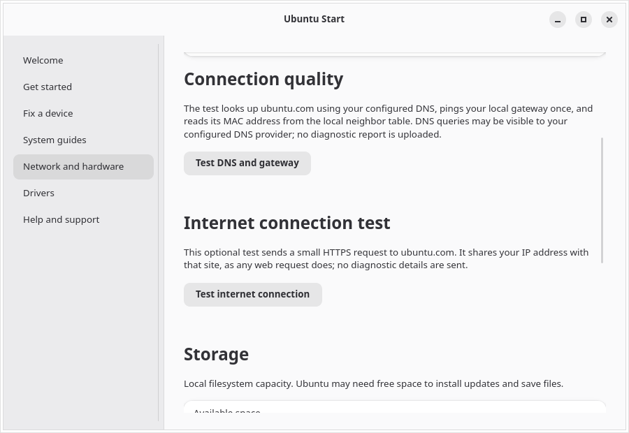
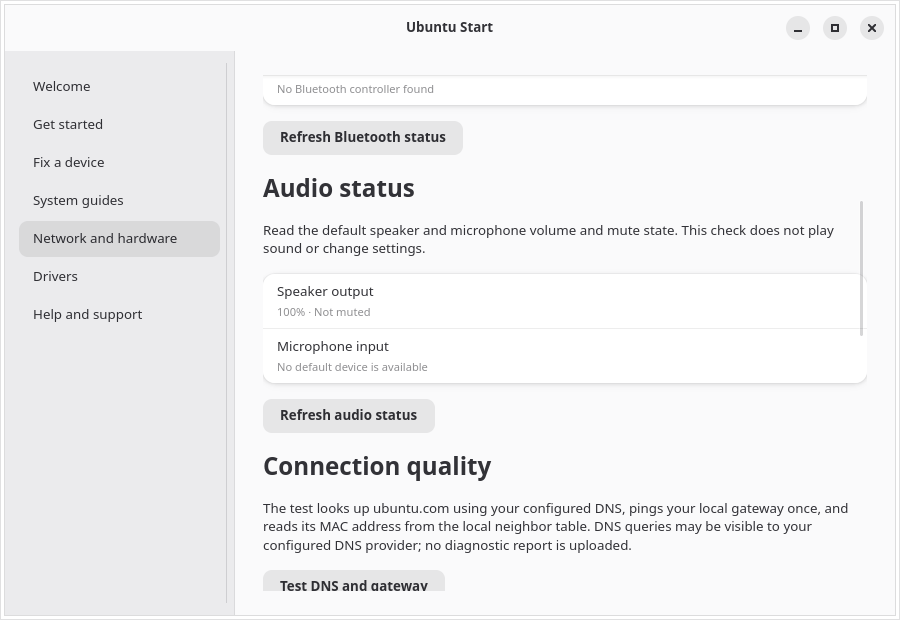
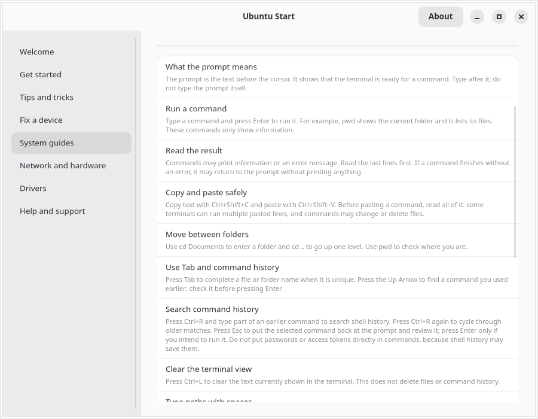
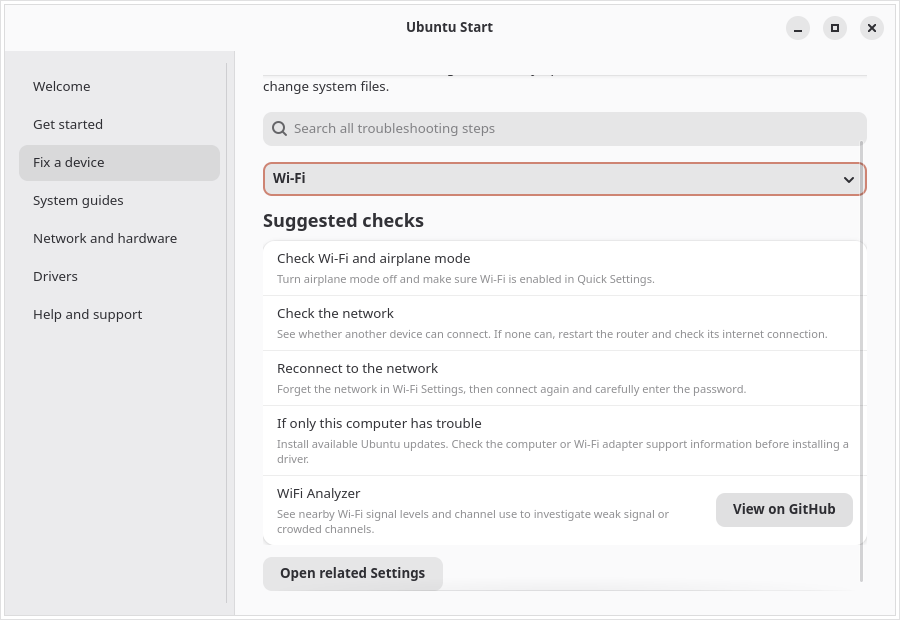
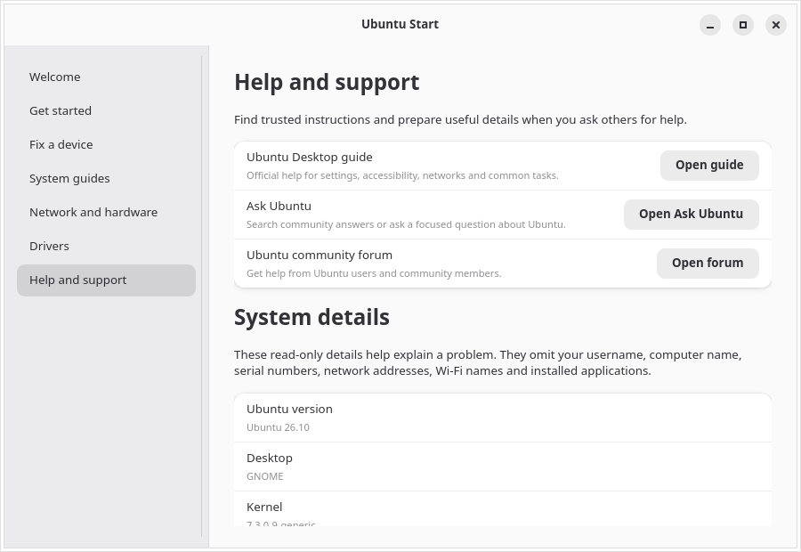
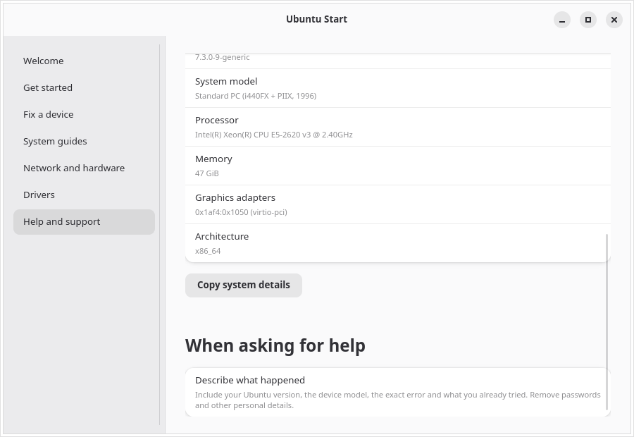
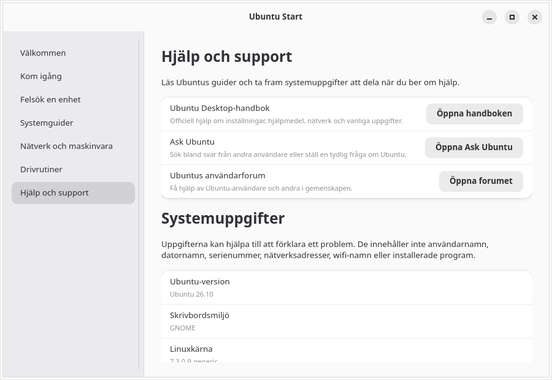

# Ubuntu Start

An Ubuntu Desktop guide for first-run setup and device troubleshooting.


[Swedish welcome screen](screenshots/welcome-sv.png) · [More screenshots](screenshots/)










[Swedish system guides](screenshots/system-guides-sv.png) · [Swedish network and hardware overview](screenshots/network-hardware-sv.png) · [Swedish diagnostics](screenshots/network-diagnostics-sv.png) · [Swedish audio status](screenshots/audio-status-sv.png) · [Swedish terminal guide](screenshots/terminal-guide-sv.png) · [Swedish Wi-Fi analyzer recommendation](screenshots/wifi-analyzer-sv.png)







[Swedish hardware summary](screenshots/help-hardware-sv.png) · [Accessibility settings opened from the guide](screenshots/accessibility-panel-en.png)


Ubuntu Start combines a first-run guide with practical device troubleshooting for Ubuntu Desktop. It is a GTK 4/libadwaita application intended for Ubuntu GNOME.

## Contributing

See [CONTRIBUTING.md](CONTRIBUTING.md) for contributor guidance and the maintainer pull request review process.

## Current scope

- First steps for language, networking, updates, sound, display and privacy.
- Everyday tips for search, window management and Files, plus guidance on backups and choosing trusted app sources.
- Search device checks and step-by-step system guides together, then open a matching guide directly. Topics include sound, Bluetooth, batteries, printers, displays/graphics, keyboards, touchpads, Wi-Fi, Ethernet, cameras, accessibility and Terminal basics.
- Step-by-step guides for installing apps, updates, Wi-Fi, Ethernet, printers, batteries, keyboards, touchpads, larger text, screen magnification and the Orca screen reader.
- Accessibility guides explain larger text, zoom, screen reading, the on-screen keyboard, typing assistance and visual sound alerts, with plain-language steps before each change.
- A beginner-friendly Terminal guide explains the prompt, command output and errors, `pwd`, `ls`, `cd`, paths with spaces, Tab completion, command history, `--help`, `man`, `sudo` and safe ways to stop a command.
- Optional connection diagnostics report DNS lookup and gateway ping latency in milliseconds, plus the gateway MAC address and a local OUI vendor match. The test asks before running; it sends one DNS lookup to the configured resolver and one ping to the local gateway.
- Read-only Bluetooth status reports whether a controller is present and powered on without scanning for nearby devices.
- Read-only audio status checks the default speaker and microphone volume and mute state through PipeWire or PulseAudio without playing sounds or changing settings.
- Wi-Fi troubleshooting recommends [WiFi Analyzer](https://github.com/yeager/wifi-analyzer) for nearby signal levels and channel use. Opening GitHub requires confirmation.
- Built-in links to official Ubuntu documentation, Ask Ubuntu and the Ubuntu support forum.
- Read-only NetworkManager, Bluetooth, hardware and storage summaries, battery charge and estimated capacity versus original design when exposed, plus a copyable support report that omits usernames, host names, serial numbers, network addresses, Wi-Fi names and installed applications.
- Links into GNOME Control Center and Ubuntu's Additional Drivers tool. System changes remain in Ubuntu's own tools and require the user's confirmation.
- gettext-based localization with English source strings and a complete Swedish (`sv`) catalog.

## Build and run on Ubuntu

Install the platform dependencies, then build with Meson:

```sh
sudo apt install python3-gi gir1.2-gtk-4.0 gir1.2-adw-1 gettext meson ninja-build
meson setup build --prefix=/usr
meson compile -C build
sudo meson install -C build
```

For a source checkout, run `python3 src/ubuntu_start.py` to use the English source strings. To try the Swedish catalog from the checkout:

```sh
mkdir -p build/locale/sv/LC_MESSAGES
msgfmt po/sv.po -o build/locale/sv/LC_MESSAGES/ubuntu-start.mo
LANGUAGE=sv UBUNTU_START_LOCALEDIR="$PWD/build/locale" python3 src/ubuntu_start.py
```

Run the unit tests with `PYTHONPATH=src python3 -m unittest discover -s tests -v`. The CI workflow runs these tests and builds the app for pull requests.

NetworkManager, Bluetooth, audio, storage, battery and hardware summaries use local system information. DNS/gateway tests and the WiFi Analyzer GitHub link ask for confirmation before contacting an external service; DNS uses the configured resolver, ping targets the local gateway, and vendor matching uses a local OUI file when available. The separate internet test sends one HTTPS HEAD request to `ubuntu.com` after confirmation. Opening the Ubuntu App Center asks first because it may contact configured software sources; Ubuntu Start does not install apps. Other help pages open only when selected. No diagnostic report is uploaded, and serial numbers are not read. The app expects GTK 4, libadwaita and PyGObject.

## Validation

The latest local revision has 40 passing unit tests. Source-string coverage, template sync, `msgfmt` and fuzzy/untranslated checks pass; all 394 Swedish messages are translated. The staged-install checker is covered with fixtures, but the current revision has not had a Meson build or UI launch on the Ubuntu target. The README screenshots predate the latest terminal, keyboard, touchpad, battery and tips-page updates.

An earlier revision was built and staged on Ubuntu 26.10 machine `trv2`, then launched under Xvfb in English and Swedish. At that point 29 tests passed on the target, AppStream validation succeeded, the Swedish catalog had 297 translated messages and PipeWire reported an unmuted default speaker at 100% with no default microphone. The GNOME Control Center panel list confirmed the Bluetooth, Wi-Fi, printer, display, privacy, sound and keyboard panel identifiers. The two Ubuntu driver/update utilities were also installed with `dpkg -i`; Additional Drivers and Update Manager opened in Swedish, and `dpkg --audit` and `apt-get check` reported no package errors. These are historical observations from that earlier revision. Network diagnostics were not run against the real network. Xvfb does not verify physical-device behavior or hardware acceleration.

## Localization

English is the source and default language. The app uses the desktop locale to select translations; Swedish strings live in `po/sv.po`. Add more languages through gettext catalogs and list their language codes in `po/LINGUAS`. Regenerate the template with `xgettext` and validate catalogs with `msgfmt --check`.

## Current limitations

Device troubleshooting guides are instructional. Optional network diagnostics run only after confirmation, use DNS for `ubuntu.com` and ping the local gateway, and do not upload a report. The app does not install packages or run privileged operations; system changes remain in Ubuntu's own tools. Settings panel names and the Additional Drivers launcher can differ across Ubuntu releases, so validate integrations on each supported release.


## Releases

Tagged versions (`v*`) are built and published by GitHub Actions. Each release includes a source archive and SHA-256 checksum.

## Screenshots

The screenshots show the welcome page, searchable troubleshooting, system how-to guides, accessibility settings, local network and hardware information, the support summary and Ubuntu Software & Updates. The driver-tool capture was taken while Ubuntu was still scanning for available drivers.


## License

Ubuntu Start is licensed under the GNU General Public License version 3. See [LICENSE](LICENSE).
