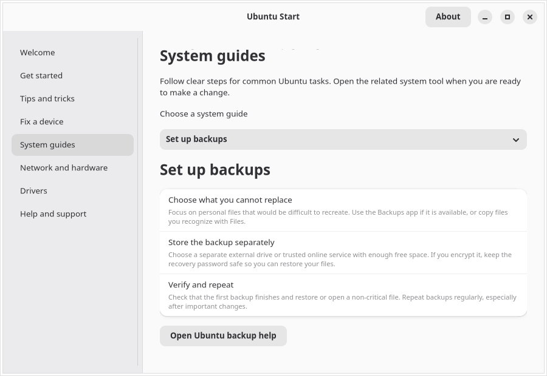
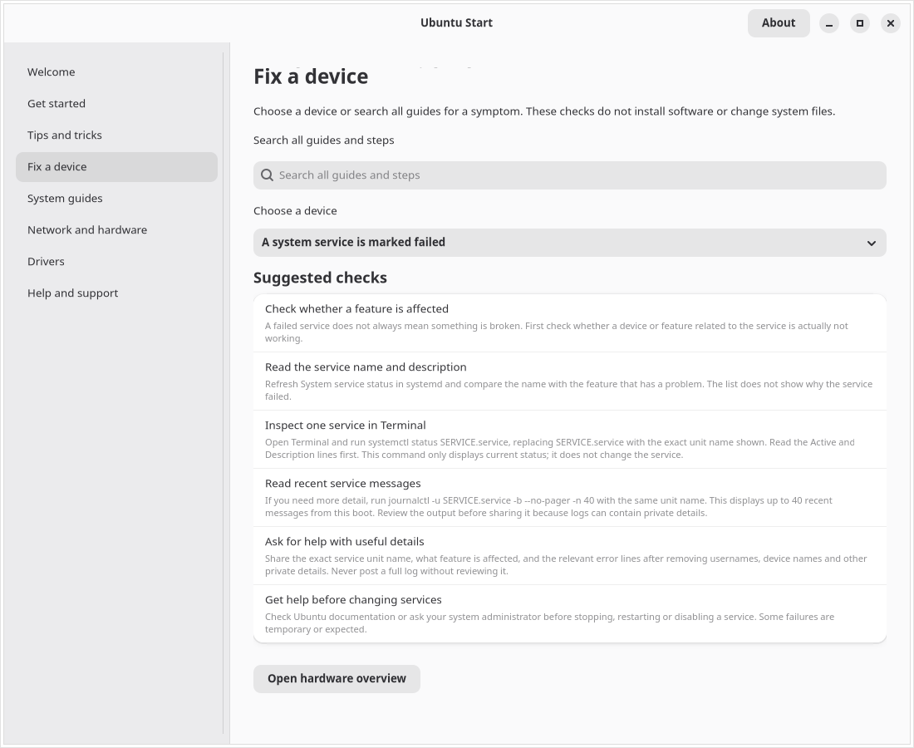

# Ubuntu Start

An Ubuntu Desktop guide for first-run setup and device troubleshooting.


[Swedish welcome screen](screenshots/welcome-sv.png) · [More screenshots](screenshots/) · [benchmark guide (EN)](screenshots/benchmark-guide-en.png) · [benchmarkguiden (SV)](screenshots/benchmark-guide-sv.png) · [benchmark results example (EN)](screenshots/benchmark-results-en.png) · [exempel på benchmarkresultat (SV)](screenshots/benchmark-results-sv.png)







[SMART drive health guide (EN)](screenshots/smart-health-en.png) · [diskhälsoguiden (SV)](screenshots/smart-health-sv.png) · [fingerprint guide (EN)](screenshots/fingerprint-en.png) · [fingeravtrycksguiden (SV)](screenshots/fingerprint-sv.png) · [More screenshots: Wi-Fi setup guide (EN)](screenshots/system-guides-en.png) · [failed service guide (SV)](screenshots/service-status-sv.png) · [interrupted package recovery (EN)](screenshots/package-recovery-en.png) · [återställning av avbruten paketuppdatering (SV)](screenshots/package-recovery-sv.png) · [network and hardware overview (EN)](screenshots/network-hardware-en.png) · [VPN setup guide (EN)](screenshots/vpn-en.png) · [VPN-guide (SV)](screenshots/vpn-sv.png) · [backup setup guide (SV)](screenshots/backups-sv.png) · [network diagnostics (EN)](screenshots/network-diagnostics-en.png) · [audio status (EN)](screenshots/audio-status-en.png) · [printer queues (EN)](screenshots/printer-status-en.png) · [update and restart status (EN)](screenshots/update-status-en.png) · [accessibility status (EN)](screenshots/accessibility-status-en.png) · [expanded accessibility status (EN)](screenshots/accessibility-status-en-expanded.png) · [storage and battery (EN)](screenshots/storage-en.png) · [free-space guide (EN)](screenshots/storage-guide-en.png) · [system details and storage (EN)](screenshots/copy-system-details-en.png) · [USB hardware (EN)](screenshots/hardware-usb-en.png) · [Terminal guide (EN)](screenshots/terminal-guide-en.png) · [WiFi Analyzer recommendation (EN)](screenshots/wifi-analyzer-en.png) · [help page (EN)](screenshots/help-en.png) · [hardware summary (EN)](screenshots/help-hardware-en.png) · [date and time status (EN)](screenshots/date-time-en-detail.png)

[Swedish system guides](screenshots/system-guides-sv.png) · [återställning av avbruten paketuppdatering](screenshots/package-recovery-sv.png) · [network and hardware overview](screenshots/network-hardware-sv.png) · [network diagnostics](screenshots/network-diagnostics-sv.png) · [audio status](screenshots/audio-status-sv.png) · [printer queues](screenshots/printer-status-sv.png) · [uppdaterings- och omstartsstatus](screenshots/update-status-sv.png) · [accessibility status](screenshots/accessibility-status-sv.png) · [utökad tillgänglighetsstatus](screenshots/accessibility-status-sv-expanded.png) · [storage and battery](screenshots/storage-sv.png) · [free-space guide](screenshots/storage-guide-sv.png) · [system details and storage](screenshots/copy-system-details-sv.png) · [USB hardware](screenshots/hardware-usb-sv.png) · [Terminal guide](screenshots/terminal-guide-sv.png) · [WiFi Analyzer recommendation](screenshots/wifi-analyzer-sv.png) · [help page](screenshots/help-sv.png) · [hardware summary](screenshots/help-hardware-sv.png) · [accessibility settings](screenshots/accessibility-panel-en.png) · [datum- och tidsstatus](screenshots/date-time-sv-detail.png)


Ubuntu Start combines a first-run guide with practical device troubleshooting for Ubuntu Desktop. It is a GTK 4/libadwaita application intended for Ubuntu GNOME.

## Contributing

See [CONTRIBUTING.md](CONTRIBUTING.md) for contributor guidance and the maintainer pull request review process.

## Current scope

- First steps for language, networking, updates, sound, display and privacy.
- Everyday tips for search, window management and Files, plus guidance on backups and choosing trusted app sources.
- A first-run checklist for language and keyboard, network, updates, sound and display, privacy and accessibility. Users mark steps complete themselves; progress is saved locally in a private file and can be reset at any time.
- Search device checks and step-by-step system guides together, then open a matching guide directly. Topics include sound, Bluetooth, batteries, USB devices, printers, displays/graphics, keyboards, touchpads, Wi-Fi, Ethernet, VPNs, cameras, storage, fingerprint readers, accessibility and Terminal basics.
- A searchable PCI troubleshooting guide and local PCI device list show hardware IDs and attached kernel drivers; PCI bridges are omitted and a missing driver is not presented as a confirmed fault.
- A drive-health guide explains how to review SMART data and run a short self-test in GNOME Disks, with backup-first advice and clear limits when SMART is unavailable.
- A searchable fingerprint-reader guide explains GNOME enrollment, safe sign-in testing, password fallback and what to check when the reader is unsupported or missing.
- An on-demand Wi-Fi quick check combines local NetworkManager, radio-block and IP-address status to suggest next steps; it does not contact the internet or scan nearby networks.
- Dedicated USB, external-display, Bluetooth pairing and Bluetooth audio guides help isolate connection, port, cable, input, adapter, pairing and headset profile problems.
- A read-only display status check lists Linux DRM connector connection state and whether a connector is active. It does not read monitor EDID or serial numbers; some drivers and virtual machines do not expose connector data.
- A read-only systemd startup timing check and searchable guide explain reported boot phases, what timing omits after sign-in and why one result is not a reason to disable services.
- Step-by-step guides for freeing disk space safely, installing apps, updates, Wi-Fi signal and disconnect problems, Wi-Fi sign-in pages and internet access, VPNs, Ethernet, printers, batteries, keyboards, touchpads, larger text, screen magnification and the Orca screen reader.
- Accessibility guides explain larger text, zoom, screen reading, the on-screen keyboard, typing assistance, controlling the pointer from the keyboard and visual sound alerts, with plain-language steps before each change.
- A read-only accessibility summary shows GNOME screen reader, magnifier, on-screen keyboard, high contrast, Sticky Keys, Slow Keys, Bounce Keys, Mouse Keys, visual sound alerts, text scaling and pointer size settings when available. A button opens Ubuntu's Accessibility Settings to make changes; Ubuntu Start never changes them itself.
- A read-only date and time summary shows the local time zone, whether automatic synchronization is supported and enabled, and whether the clock is synchronized. It offers relevant next steps when automatic sync is unavailable or the clock is not synchronized, and opens the matching step-by-step guide. It reads `timedatectl` status only; it does not contact a time server, start synchronization or change settings.
- Refreshable resource summaries show total and available RAM, estimated use and swap use from local `/proc/meminfo`, plus Linux pressure-stall averages for CPU, memory and storage I/O. `Some` reports when at least one task was stalled; memory and storage may also report `full`, when all non-idle tasks were stalled at once. These system-wide readings can help investigate slowdowns but do not identify a process or prove the cause. A searchable guide explains how to compare them, close unused apps safely, check disk space and review Ubuntu updates.
- A system service status check lists local systemd service units marked failed and their descriptions. It does not read logs or change services; help explains that failures may be temporary or expected.
- The hardware overview shows the operating system and kernel versions alongside model, processor, memory, graphics and architecture, so users can find version details without creating a support report.
- System details also show whether the current session uses Wayland, X11 or a text console when Ubuntu exposes that information. This helps when reporting display and input issues; unknown session data is shown as unavailable.
- A read-only temperature check shows values and critical limits from Linux thermal and hardware-monitor sensors when available. A searchable guide covers ventilation, interpreting model-specific limits and when to shut down and seek support; the app does not run stress tests or change fan settings.
- A local Ubuntu update check simulates `apt-get upgrade` against cached package lists and reads Ubuntu's local reboot-required marker. It reports packages ready to upgrade, packages held back, when the lists were last refreshed and whether Ubuntu has marked that a restart is required, then lets the user open Software Updater. It does not contact a network, refresh lists, install anything or restart the computer.
- A searchable release-upgrade guide explains LTS and interim support periods, backup and disk-space preparation, supported sequential upgrade paths and why an upgrade prompt may not be available yet. The lifecycle and upgrade documentation links open only after confirmation.
- A beginner-friendly Terminal guide explains the prompt, command output and errors, `pwd`, `ls`, `cd`, paths with spaces, Tab completion, command history, `--help`, `man`, safe copy and paste, password prompts, commands that take time and safe ways to stop a command.
- Optional connection diagnostics report DNS lookup and gateway ping latency in milliseconds, plus the gateway MAC address and a local IEEE vendor match. More-specific MA-M, MA-S and IAB assignments take precedence over broad OUI matches. The test asks before running; it sends one DNS lookup to the configured resolver and one ping to the local gateway. If `ping` is missing, Ubuntu Start reports that the gateway test could not run instead of treating the gateway as unreachable.
- A read-only wireless radio check distinguishes software blocks, such as airplane mode, from hard blocks reported by hardware or firmware when Linux exposes those flags. It does not toggle radios and provides a direct link to the Wi-Fi guide.
- DNS and gateway results include elapsed milliseconds and clear next steps when checks fail, while explaining that some gateways block ping.
- A searchable connection-results guide explains what DNS and gateway timings measure, how to compare them, why a missed ping does not prove an outage, and the limits of a local MAC vendor match. Its shortcut opens the network diagnostics card.
- Read-only Bluetooth status reports whether a controller is present and powered on without scanning for nearby devices. When a controller is exposed, it also distinguishes inactive or failed Bluetooth services and links directly to the pairing guide.
- Read-only audio status shows default speaker and microphone names when PipeWire exposes them, along with volume and mute state through PipeWire or PulseAudio. Muted, zero-volume or missing-device statuses suggest a next step. Buttons open Sound Settings or the sound and microphone guide; the app does not play sound or change settings.
- Read-only printer status lists queue names and basic states from the local CUPS service, with unfinished-job counts when CUPS provides them. It does not expose job names or owners, send or cancel print jobs, or contact printers directly. A searchable guide explains how to check a paused queue safely and avoid affecting other users' jobs on shared printers.
- Read-only video status lists device names reported by Linux's video4linux subsystem and links to the camera troubleshooting guide. It does not open camera devices or test video or audio; a missing device can also result from a privacy switch, permissions or driver support.
- A searchable guide for slow or unstable Wi-Fi explains how to compare the connection near the router, interpret the active link metrics, compare another device and check nearby channel use. It recommends [WiFi Analyzer](https://github.com/yeager/wifi-analyzer) for nearby signal levels and channel use; opening the project page requires confirmation.
- Built-in links to official Ubuntu documentation, Ask Ubuntu and the Ubuntu support forum.
- Read-only NetworkManager, Bluetooth, USB, PCI hardware and storage summaries, battery charge and estimated capacity versus original design when exposed. Connected network interfaces show whether IPv4 or IPv6 addresses are assigned, without displaying the address values. The USB list shows device descriptors, hardware IDs and bound kernel drivers without reading serial numbers. Manufacturer and product names are matched against an installed local `usb.ids` database when available; hardware IDs remain visible for reference. The PCI list reports local hardware IDs and attached drivers, omitting PCI bridges; names are matched against an installed local PCI ID database when available. Storage shows the system filesystem and, when it is a separate mounted volume, the home filesystem too; it flags volumes that are almost full or mounted read-only. Graphics adapters are matched against an installed local PCI ID database when available, with the numeric IDs retained for reference. If the optional `iw` tool is installed, active Wi-Fi status also shows signal strength and receive/transmit link rates without collecting the network name or scanning nearby networks. Link rates are not internet speed tests. System details include the Ubuntu Start and Ubuntu versions. A copyable support report omits usernames, host names, serial numbers, network addresses, Wi-Fi names and installed applications.
- Network status associates a local PCI or USB hardware ID and kernel driver with each interface when sysfs exposes them, and matches the adapter name against installed local PCI/USB ID databases. It does not read serial numbers or scan nearby networks.
- A local support report can be reviewed and edited before saving. It includes Ubuntu Start and Ubuntu versions, connected USB and PCI device names, hardware IDs and driver names without serial numbers, available space on the system filesystem and any separate home filesystem, plus optional DNS/gateway timing. It reports a gateway as reachable only after a ping reply; missing replies remain unknown because routers can filter ping. The report excludes network addresses, interfaces, MAC addresses and vendor matches. The app does not upload it.
- Search and guide selectors have visible labels for assistive technology, and guides remain navigable with the keyboard.
- Links into GNOME Control Center and Ubuntu's Additional Drivers tool. System changes remain in Ubuntu's own tools and require the user's confirmation.
- A read-only Secure Boot check uses `mokutil` when installed and explains how firmware state can affect some third-party drivers. Ubuntu Start does not change firmware settings or enroll keys.
- gettext-based localization with English source strings and a complete Swedish (`sv`) catalog.

## Build and run on Ubuntu

Install the platform dependencies, then build with Meson:

```sh
sudo apt install python3-gi gir1.2-gtk-4.0 gir1.2-adw-1 gettext meson ninja-build
meson setup build --prefix=/usr
meson compile -C build
sudo meson install -C build
```

To build an installable Debian package after installing the dependencies, run `scripts/build-deb.sh`. It creates `build/packages/ubuntu-start_0.3.18-1_all.deb`. Install it with `sudo apt install ./build/packages/ubuntu-start_0.3.18-1_all.deb`; APT resolves the declared GTK and Python runtime dependencies.

The wheel and source distribution are published on [PyPI](https://pypi.org/project/ubuntu-start/). Install the GTK platform dependencies with APT first, then install the package in an isolated environment that can access system PyGObject bindings:

```sh
sudo apt install python3-gi gir1.2-gtk-4.0 gir1.2-adw-1 gettext
python3 -m venv --system-site-packages .venv
. .venv/bin/activate
python -m pip install ubuntu-start
ubuntu-start
```

For a source checkout, run `python3 src/ubuntu_start.py` to use the English source strings. To try the Swedish catalog from the checkout:

```sh
mkdir -p build/locale/sv/LC_MESSAGES
msgfmt po/sv.po -o build/locale/sv/LC_MESSAGES/ubuntu-start.mo
LANGUAGE=sv UBUNTU_START_LOCALEDIR="$PWD/build/locale" python3 src/ubuntu_start.py
```

Run the unit tests with `PYTHONPATH=src python3 -m unittest discover -s tests -v`. The CI workflow runs these tests and builds the app on Ubuntu 24.04 and 26.04, and checks it in an Ubuntu 26.10 container.

NetworkManager, Bluetooth, audio, storage, battery and hardware summaries use local system information. DNS/gateway tests and the WiFi Analyzer GitHub link ask for confirmation before contacting an external service; DNS uses the configured resolver, ping targets the local gateway, and vendor matching uses installed local IEEE assignment files when available. The separate internet test sends one HTTPS HEAD request to `ubuntu.com` after confirmation. Opening the Ubuntu App Center asks first because it may contact configured software sources; Ubuntu Start does not install apps. Other help pages open only when selected. No diagnostic report is uploaded, and serial numbers are not read. The app expects GTK 4, libadwaita and PyGObject.

## Validation

Version `0.3.34` matches gateway vendors against local IEEE MA-M, MA-S and IAB assignment ranges, preferring the most specific match over a broad OUI entry.

Version `0.3.33` rejects invalid and multicast gateway MAC addresses and skips manufacturer lookup for locally administered MAC addresses, which do not identify an IEEE OUI.

Version `0.3.32` rejects malformed default-route output when identifying the local network gateway.

Version `0.3.31` shows the installed Ubuntu Start version in About and local system details, including for Debian package installations.

Version `0.3.30` reuses the existing application window on activation, avoiding duplicate Ubuntu Start windows.

Version `0.3.29` keeps support-report JSON errors inside the editor and announces them to screen readers, so users can correct the report without losing the dialog.

Version `0.3.28` validates edited support reports before saving so invalid JSON is not stored with a `.json` extension.

Version `0.3.27` escapes Pango markup in preference-row text so labels containing ampersands display correctly. The AT-SPI check now activates the graphical startup-chain control and verifies that the returned chain is exposed. On `trv2` with Ubuntu 26.10, all 311 unit tests and English and Swedish Xvfb/AT-SPI checks passed for version `0.3.27`. Version `0.3.25` adds an optional, read-only view of systemd's dependency chain to `graphical.target`. It explains the `@` activation time and `+` startup duration, and notes that the chain is one dependency path and service names may reveal installed software. On `trv2` with Ubuntu 26.10, all 308 unit tests, English and Swedish Xvfb/AT-SPI checks, staged installation, Debian package build, 1,079-message Swedish catalog validation and AppStream validation passed for version `0.3.25`. Version `0.3.24` adds a read-only systemd startup timing check and a guide explaining the reported boot phases, what the measurement omits after sign-in, and why one result is not a reason to disable services. On `trv2` with Ubuntu 26.10, all 304 unit tests, English and Swedish Xvfb/AT-SPI checks, staged installation, Debian package build, 1,071-message Swedish catalog validation and AppStream validation passed for version `0.3.24`. Version `0.3.23` adds a searchable Bluetooth audio guide with headset output selection, microphone checks for calls and a plain-language explanation of audio profile changes. On `trv2` with Ubuntu 26.10, all 295 unit tests, English and Swedish Xvfb/AT-SPI checks, staged installation, Debian package build, 1,051-message Swedish catalog validation and AppStream validation passed for version `0.3.23`. Version `0.3.22` adds a guide to automatic screen locking and explains how session locking differs from disk encryption. On `trv2` with Ubuntu 26.10, all 293 unit tests, English and Swedish Xvfb/AT-SPI checks, staged installation, Debian package build, 1,039-message Swedish catalog validation and AppStream validation passed for version `0.3.22`. Version `0.3.21` adds a searchable guide to restore files from Déjà Dup, with a separate-folder-first workflow and advice to verify restored files before replacing current copies. On `trv2` with Ubuntu 26.10, all 292 unit tests, English and Swedish Xvfb/AT-SPI checks, staged installation, Debian package build, 1,028-message Swedish catalog validation and AppStream validation passed for version `0.3.21`. Version `0.3.20` adds a local check for Ubuntu’s Déjà Dup Backups app, with direct next steps while preserving backup privacy. On `trv2` with Ubuntu 26.10, all 291 unit tests, English and Swedish Xvfb/AT-SPI checks, staged installation, Debian package build, 1,017-message Swedish catalog validation and AppStream validation passed for version `0.3.20`. Version `0.3.19` adds a searchable fingerprint-reader guide with GNOME enrollment steps, safe sign-in testing, password fallback and guidance for unsupported readers. Version `0.3.18` added a searchable guide for checking storage-drive health with SMART in GNOME Disks, including backup-first advice, device limitations and next steps for warnings. Version `0.3.17` updates the app, desktop launcher, icon and AppStream identifiers to `se.danielnylander.UbuntuStart`; the Debian package name and local user-data paths remain stable. Version `0.3.16` adds safe, step-by-step guidance for recovering from interrupted package updates, including reviewing APT's proposed changes before confirming them. Version `0.3.15` added beginner-friendly guidance for searching command history with Ctrl+R and clearing the terminal view with Ctrl+L, with a warning not to put secrets in commands. On Ubuntu 26.10, all 277 unit tests, English and Swedish Xvfb/AT-SPI checks, staged installation checks, Debian package build, Swedish catalog validation and AppStream validation passed for version `0.3.15`. Version `0.3.14` adds local/remote desktop-session status to system details and the optional support report, without including remote host details. On Ubuntu 26.10 machine `trv2`, the live logind check identified the active GNOME Wayland session as remote. All 276 unit tests and both English and Swedish Xvfb/AT-SPI checks passed for version `0.3.14`. Version `0.3.13` added step-by-step instructions for inspecting a failed system service and reviewing recent log messages safely. The prior `0.3.13-1` package installed with clean `dpkg --audit` and `apt-get check` results. A live-session check confirmed GNOME Wayland over RDP with Ubuntu Start running in that session. AT-SPI exposed the `Ubuntu Start` frame and reported it as visible. Pixel-level display rendering and physical device behavior remain unverified.

The CI workflow launches the application under Xvfb and checks its AT-SPI tree. On Ubuntu 24.04, 26.04 and 26.10, it verifies that all eight guide pages are named list items, the English and Swedish system-details pages expose the Ubuntu Start version, the About, USB, video and display controls are named buttons, the Mouse Keys status row is exposed, and Ctrl+F moves keyboard focus to the named guide-search entry; Orca 51 also lists the app on `trv2`. The released app has also passed a local GTK smoke test on Ubuntu 26.10. Earlier checks confirmed search behavior in a live GTK session and the Bluetooth, Wi-Fi, printer, display, privacy, sound and keyboard panel identifiers in GNOME Control Center. The two Ubuntu driver/update utilities were installed with `dpkg -i`; Additional Drivers and Update Manager opened in Swedish, and `dpkg --audit` and `apt-get check` reported no package errors. Those device and utility checks apply to the earlier revision. Xvfb does not verify physical-device behavior, hardware acceleration or GNOME/Wayland rendering.

## Localization

English is the source and default language. The app uses the desktop locale to select translations. Add languages through gettext catalogs and list their codes in `po/LINGUAS`. Regenerate the template with `xgettext` and validate catalogs with `msgfmt --check`.

| Language | Code | Status |
| --- | --- | --- |
| English (source) | `en` | Complete |
| Swedish | `sv` | Complete |

See [po/README.md](po/README.md) for instructions on updating Swedish translations and contributing another language.

## Current limitations

The backup availability check only reports whether Déjà Dup is installed locally. It does not inspect personal files, backup destinations or backup history, and it cannot confirm that backups are configured or recent. Use Ubuntu’s Backups app or copy important files to a separate drive, then verify that you can restore a file.

Ubuntu Start targets Ubuntu Desktop with GNOME. Device guides explain checks for the user to perform; they do not identify physical faults or change the system. Temperature values depend on sensors exposed by Linux and may be missing on some computers and virtual machines. Wireless radio block status depends on the `rfkill` interface being exposed by Linux and can be unavailable on some hardware. Secure Boot status depends on firmware support and the optional `mokutil` utility; unavailable status does not mean that Secure Boot is enabled or disabled. Network diagnostics ask first, make one DNS lookup for `ubuntu.com` and one ping to the local gateway, and do not upload a report. Fingerprint sign-in depends on hardware and software support in Ubuntu; a missing Fingerprint Login option does not by itself prove that the reader is faulty. The copyable system-details report includes whether logind reports the active desktop session as local or remote. It does not include the remote host name or address. The update status check uses only existing APT package lists, so its results can be out of date; open Software Updater to refresh the lists and review changes. The optional package health check runs the local `dpkg --audit` report and lists package entries it flags; it does not repair packages. Review any proposed changes in Ubuntu's own tools. The app does not install packages, drivers or run privileged operations. GNOME panel names and the Additional Drivers launcher can vary by Ubuntu release. If a shortcut does not open the expected page, open Settings and choose the section manually. For drivers, search for Software & Updates and select Additional Drivers.

## Performance benchmarks

The CPU benchmark runs a short, single-threaded integer workload after confirmation. Its iterations-per-second result measures this app's workload, not total multi-core performance; compare it on the same computer and app version, with similar power and thermal conditions. The readiness check reports available system pressure, battery, power profile and temperature context and suggests steps when those readings may affect results. It distinguishes normal readings from unavailable data; its short-term indicators are not a diagnosis and it does not change settings. A searchable guide explains how to improve and compare results safely. The graphics benchmark requires `glmark2` to be installed. After confirmation, Ubuntu Start runs it and reads its final score. The most recent CPU and graphics scores are stored locally in `$XDG_STATE_HOME/ubuntu-start/benchmarks.json` (normally `~/.local/state/ubuntu-start/benchmarks.json`) so they remain available after the app closes; use **Clear saved benchmark results** to remove them. Baselines apply only to the same app version, and graphics baselines also match the X11 or Wayland session. You can cancel a running graphics benchmark from Ubuntu Start. Results depend on the driver, display and desktop session, so keep those conditions similar when comparing. Disk measurements use GNOME Disks. Start with its read-only benchmark. The optional write benchmark is behind a separate confirmation because it writes to the selected drive and may require administrator approval; make sure you have a current backup. Benchmark scores are not included in support reports, uploaded or combined into a universal score.


## Releases

Tagged versions (`v*`) are built by GitHub Actions. Releases include a source archive, an installable `.deb` package and SHA-256 checksums. The workflow also publishes the Python wheel and source distribution to PyPI after the repository is registered as a Trusted Publisher.

## Screenshots

The screenshots show the welcome page, printer troubleshooting and queue status, backup setup, accessibility instructions and network status. Additional English and Swedish screenshots include Wi-Fi, VPN and backup guides, update and restart status, live accessibility and date/time status, storage, safe disk cleanup guidance, battery, support-report system details and connected USB hardware.


## License

Ubuntu Start is licensed under the GNU General Public License version 3. See [LICENSE](LICENSE).
