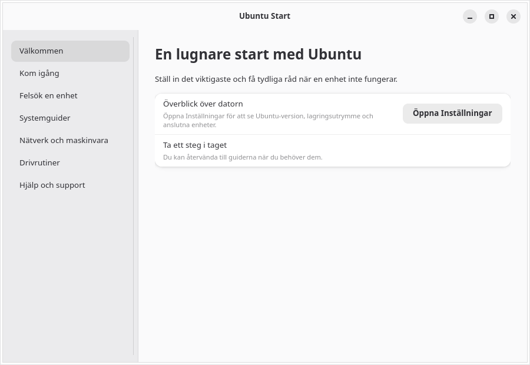
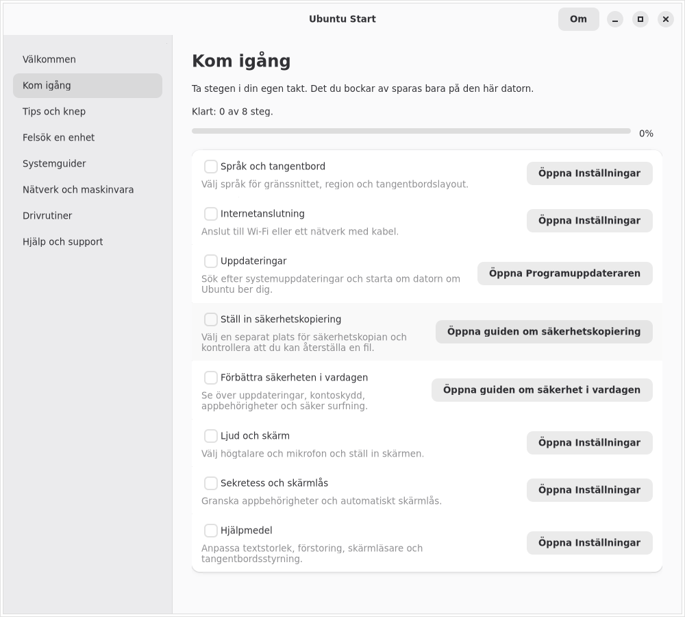
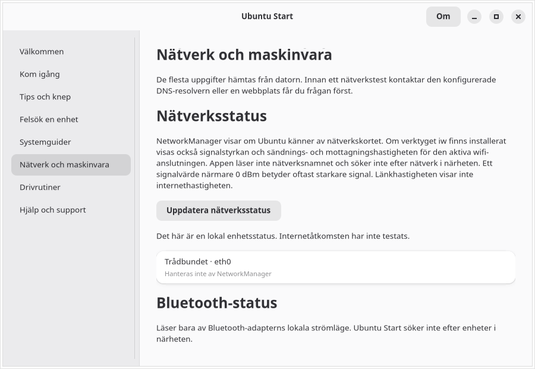
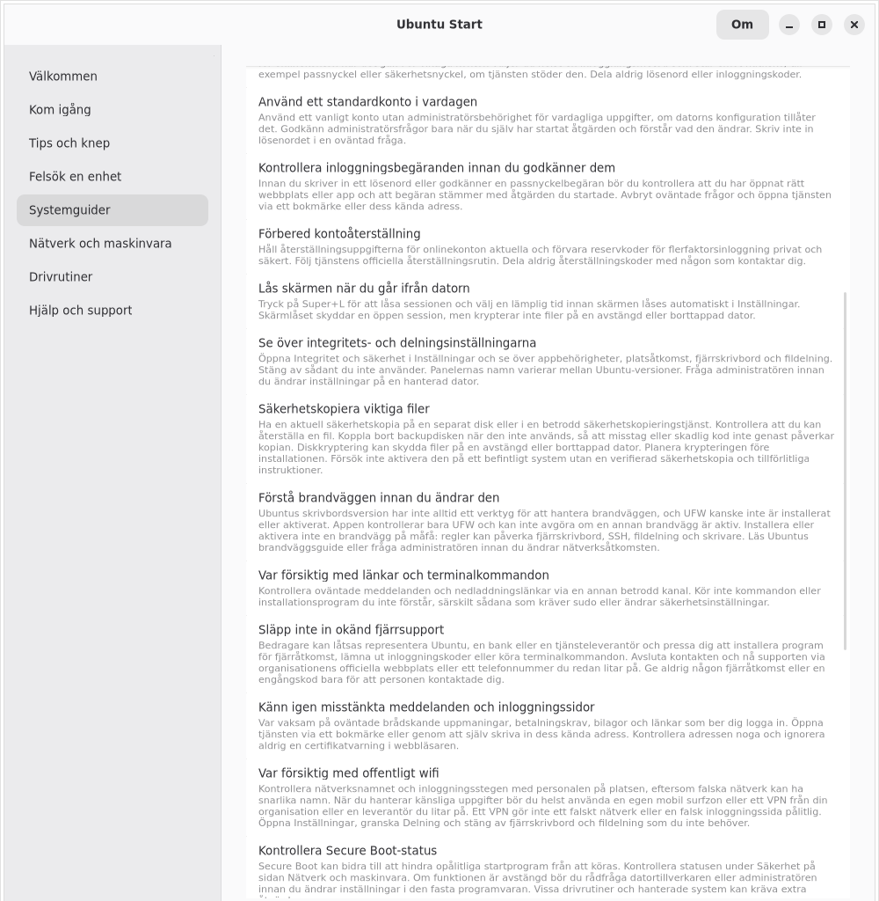
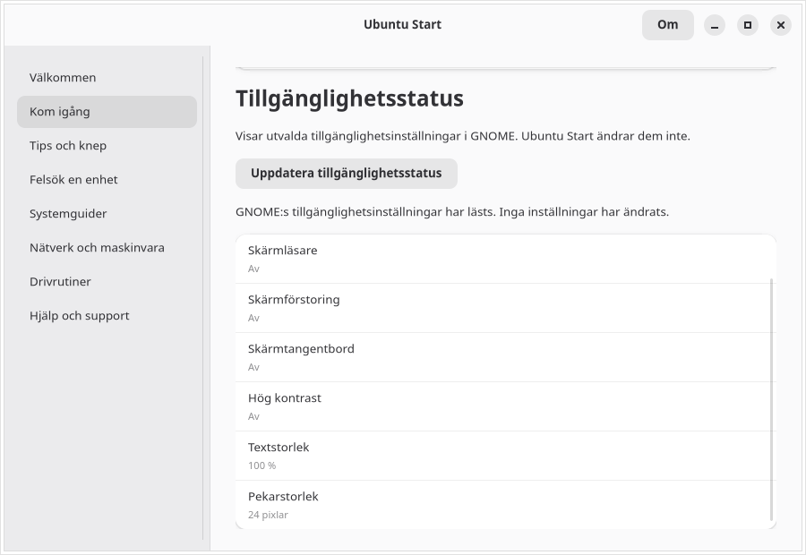
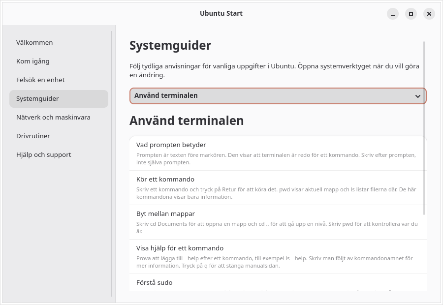

# Ubuntu Start: en lugnare väg in i Ubuntu

Det är lätt att hamna i ett läge där en ny dator ber om beslut innan man ens hunnit lära känna skrivbordet. Ska man uppdatera direkt? Var ändrar man tangentbordet? Vad gör man när skrivaren, nätverket eller ljudet inte fungerar?

Ubuntu Start är en liten guide för Ubuntu Desktop med GNOME. Den samlar de första stegen och vanliga felsökningssituationer på ett ställe, utan att ta över datorn. Appen ändrar inte systeminställningar, installerar inga paket och kör inga administrativa kommandon. Den förklarar vad du kan kontrollera och öppnar Ubuntus egna verktyg när du själv vill gå vidare.



## Börja där du är

På sidan Kom igång finns en enkel checklista för språk och tangentbord, nätverk, uppdateringar, säkerhet, säkerhetskopiering, ljud, bildskärm, integritet och hjälpmedel. Framstegen sparas lokalt på datorn, men checklistan går också att nollställa när den inte längre behövs.



Det viktigaste är inte att bocka av allt. Tanken är att du ska kunna ta en sak i taget, återvända senare och hitta tillbaka till samma råd när något har ändrats.

## Hjälp när något inte fungerar

Felsökningsguiderna börjar med sådant som går att kontrollera utan risk: kabel, ström, nätverksanslutning, rätt inmatning på skärmen eller en inställning som råkat stängas av. Om problemet finns kvar fortsätter guiden med nästa lämpliga kontroll.

I version 0.3.58 har guiderna fått ett tydligare upplägg för den som är ny i Linux. De uppmanar till att börja med första steget och stanna när problemet är löst. De kortare guiderna anpassar också sin höjd efter innehållet, i stället för att lämna en stor tom yta.



Nätverks- och maskinvarusidan visar lokal information om exempelvis lagring, anslutna USB-enheter, drivrutiner och status för systemet. Vid behov kan du själv välja att köra DNS- och gatewaytester. De frågar först, visar svarstider i millisekunder och laddar inte upp någon rapport.

## Säkerhet och integritet utan genvägar som gör ändringar

Säkerhetsguiden handlar om vardagliga saker: uppdateringar, säkra programkällor, starka lösenord, säkerhetskopiering, låsskärm, falsk fjärrsupport och misstänkta länkar. Den förklarar också varför ett råd kan vara olämpligt på en jobb- eller skoldator som styrs av en administratör.



Det finns en tydlig gräns i appen: Ubuntu Start visar information och vägleder, medan du gör systemändringen i Ubuntus egna inställningar eller verktyg. Det gör det lättare att förstå vad som händer innan du bekräftar något.

## Hjälpmedel och terminalen på vanlig svenska

Tillgänglighet ska inte vara en eftertanke. Ubuntu Start samlar råd om större text, skärmförstorare, skärmläsaren Orca, skärmtangentbord och tangentbordsinställningar. Den visar även utvalda aktuella GNOME-inställningar utan att ändra dem.



Det finns också en grundläggande terminalguide. Den går igenom vad prompten betyder, hur du läser ett resultat, hur `pwd`, `ls` och `cd` fungerar och varför man ska läsa ett kommando innan man klistrar in det. Målet är inte att göra alla till systemadministratörer, utan att ge en trygg första förståelse.



## Ubuntu först, andra skrivbord med tydlig vägledning

Ubuntu Start är gjord för Ubuntu GNOME. I version 0.3.58 känner appen av när den körs på ett annat skrivbord, exempelvis Linux Mint, och försöker då inte öppna en Ubuntu-specifik inställningspanel som saknas. I stället får användaren en förklaring och kan följa den skriftliga guiden i sin egen inställningsapp.

Även rådet om skärmbilder har förtydligats: tangenten heter oftast Print Screen eller PrtSc, och på vissa bärbara datorer behöver man hålla ned Fn samtidigt.

## Installera Ubuntu Start

Ubuntu Start 0.3.58 finns på [GitHub Releases](https://github.com/yeager/ubuntu-start/releases/tag/v0.3.58), [PyPI](https://pypi.org/project/ubuntu-start/) och i [Yeagers APT-repo](https://yeager.github.io/debian-repo/).

För att installera en nedladdad DEB-fil:

```sh
sudo apt install ./ubuntu-start_0.3.58-1_all.deb
```

Källkoden, översättningarna och information om hur man bidrar finns på [GitHub](https://github.com/yeager/ubuntu-start). Projektet är licensierat under GPL-3.0.
